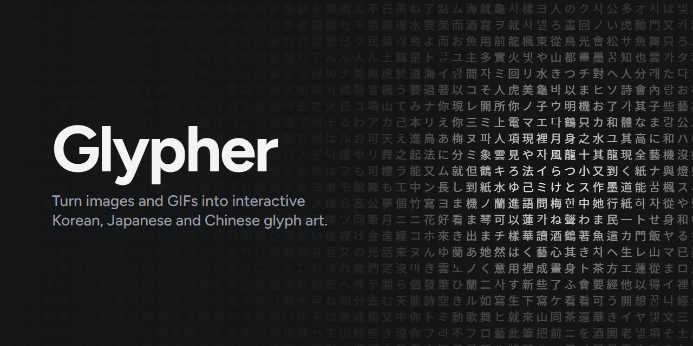

<div align="center">



<br>

[](https://github.com/DefinitivedCode/glypher/actions/workflows/ci.yml)
[](LICENSE)
[](https://github.com/DefinitivedCode/glypher/stargazers)
[](https://github.com/DefinitivedCode/glypher/commits/main)
[](CONTRIBUTING.md)


**An interactive, full-screen canvas of Korean, Japanese and Traditional Chinese glyphs.**<br>
Drop in an image or an animated GIF and it is rebuilt out of characters.<br>
Everything runs in your browser, so your images never leave your device.

### [Open the live app](https://glyph.masonmau.com)

[Features](#features) · [Quick start](#quick-start) · [Run locally](#run-it-locally) · [How it works](#how-it-works) · [Deploy](#deploy) · [Contributing](CONTRIBUTING.md)

</div>

## Features

- **Reactive background.** Glyphs light up and push away from your cursor, ripple when clicked, drift on their own, and a light sweep crosses the page. All of it is optional.
- **Image to glyphs.** Each region of your image is matched to a character with the right amount of ink, so bright areas use dense glyphs and dark areas use sparse ones.
- **Animated GIFs** play as real animations, with glyphs crossfading between frames.
- **Export** a PNG at the image's native resolution, or an animated GIF.
- **Customisable.** Scripts, glyph size, spacing, weight, contrast, sharpening, color modes (mono, accent, duotone, image colors) and more. Settings are remembered in your browser.
- **Fast.** One instanced WebGL2 draw call renders every glyph, and a Quality slider (with an Auto mode) adapts to your device.

## Quick start

Press **Ctrl/Cmd + K** to open the panel, then drop, paste or pick an image.

| Shortcut | Action |
| --- | --- |
| Ctrl/Cmd + K | Open or close the panel |
| Esc | Close the panel |
| Ctrl/Cmd + V | Paste an image from the clipboard |

### Tips

- For the most detail, lower **Glyph size**, raise **Sharpen**, and set **Glyphs** to *Density*. *Mixed* looks more varied, and *Random* leaves all the detail to brightness.
- **Fit canvas** and **Fill canvas** scale the image to the screen.
- With an image loaded, **Export PNG** renders at the image's own size, independent of your screen.

### Requirements

A browser with WebGL2 (every current desktop browser). Animated GIF import uses the `ImageDecoder` API, which needs a Chromium-based browser (Chrome, Edge, Brave, Opera). In other browsers a GIF loads as its first frame.

## Run it locally

You need [Node.js](https://nodejs.org) 20.19 or newer (22 recommended).

```bash
git clone https://github.com/DefinitivedCode/glypher.git
cd glypher
npm install
npm run dev
```

| Command | What it does |
| --- | --- |
| `npm run dev` | Start the Vite dev server with hot reload |
| `npm run build` | Typecheck, then build to `dist/` |
| `npm run typecheck` | Typecheck only |
| `npm run preview` | Serve the production build locally |
| `npm run deploy:dry` | Build and validate the Cloudflare deploy |
| `npm run deploy` | Build and deploy to Cloudflare |

## How it works

```
src/
  main.ts       App wiring: input, scene building, GIF playback, export
  renderer.ts   WebGL2 renderer. One instanced draw call; hover, ripples,
                sweep, drift and swapping are computed in the vertex shader
  glyphs.ts     Glyph sets and the texture atlas (also measures each glyph's ink)
  image.ts      Image sampling and tone mapping (auto-levels, sharpen, contrast)
  ui.ts         Settings panel, drag and drop, paste, shortcuts
  settings.ts   Defaults and persistence (localStorage)
  style.css     Panel styling
```

The CPU does almost no per-glyph work per frame. Glyphs are rasterised once into a texture atlas, and the GPU draws every cell from a few uniforms (pointer trail, ripples, time).

## Troubleshooting

- **"WebGL2 is required"**: enable hardware acceleration in your browser settings, or try another browser.
- **GIF shows one frame**: use a Chromium-based browser (see Requirements).
- **Choppy on an old device**: lower **Quality** or raise the glyph size; Auto does this for you.
- **Missing or odd characters**: glyphs come from fonts installed on your system. Install a CJK font such as Noto Sans CJK.

## Deploy

The site is static, built with Vite and served from Cloudflare Workers static assets. `wrangler.json` serves `dist/` and attaches the domain `glyph.masonmau.com`.

```bash
npx wrangler login
npm run deploy:dry
npm run deploy
```

To host it yourself, change or remove `routes` in `wrangler.json`. With several Cloudflare accounts, set `CLOUDFLARE_ACCOUNT_ID`. Caching and security headers live in `public/_headers`. Any static host also works: upload `dist/`.

---

<div align="center">

**[MIT License](LICENSE)** · Contributions are welcome, see **[CONTRIBUTING.md](CONTRIBUTING.md)**

Made by [DefinitivedCode](https://github.com/DefinitivedCode) · [glyph.masonmau.com](https://glyph.masonmau.com)

</div>
